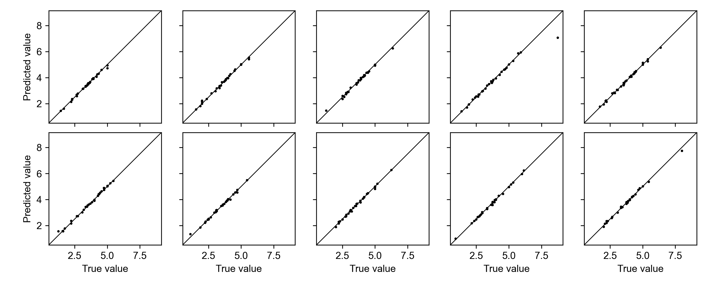
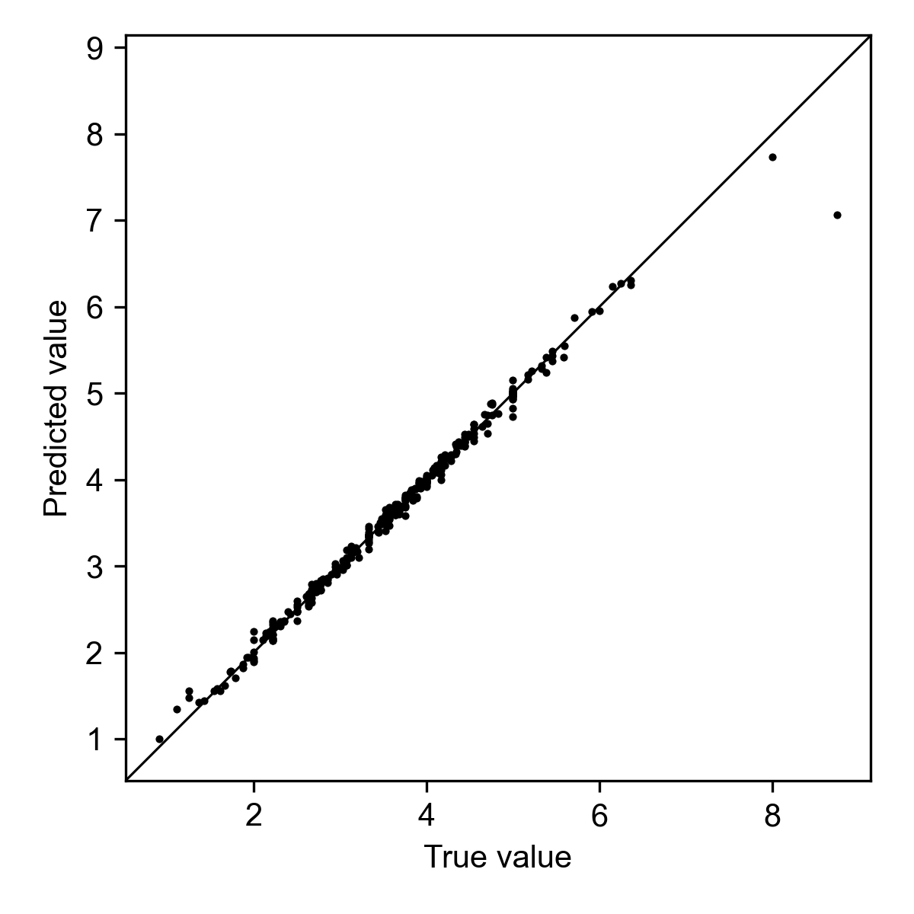

=============================================
 Evaluating a Network with Cross-Validation:
=============================================

This page walks-through a full example of using 10-fold cross-validation to validate that PARROT is training accurate and generalizeable networks. (This is cross-validation to evaluate networks; ``parrot-optimize --cv-folds`` uses cross-validation for a different purpose, to score hyperparameter configurations.) For the purposes of this example, we will use the "seq_regress_dataset.tsv" dataset found in the **/data** folder. For the purposes of this example, I'm going to be saving the split-files, networks and other output files to a folder named "cv_test". PARROT does not create output folders, so make it first:

.. code-block:: bash

    mkdir cv_test

Console excerpts below are abbreviated. Current runs additionally report
absolute regression errors and R2 and write per-protein and length-binned
evaluation tables (see :doc:`parrot-train`). The plots on this page use squared
Pearson correlation; the reported ``R2`` metric is the coefficient of
determination, which also penalizes biased or incorrectly scaled predictions.

**parrot-cvsplit**

First, let's generate the 10 different split-files using ``parrot-cvsplit``. Each of these split-files will specify a different 1/10th of the dataset to be the held-out test set. The remaining 9/10ths will be partitioned randomly into training and validation sets, 80:20.

.. code-block:: bash

    parrot-cvsplit data/seq_regress_dataset.tsv cv_test/cv_example_splits -k 10 -t 0.8

This should generate 10 files in the cv_test directory, named cv_example_splits_cv[0-9].txt (add ``--seed`` to make the same files every time).

``parrot-cvsplit`` keeps identical sequences in the same set, but, like ``--split random``, it can put similar sequences in different sets. The sequences of this example dataset were generated at random, so that does not matter here; for real proteins, where relatives are common, a network can score well on a test set by recognising relatives of its training sequences (see "parrot-cvsplit" and "parrot-preprocess").

If using optional :doc:`training_controls`, keep the policy and loss weighting
consistent across folds. Each separate ``parrot-train`` run has its own recovery
budget. For ``parrot-optimize --cv-folds``, each fold has a separate budget that
persists across search stages, and final retraining starts with a fresh budget.
Choose schedules and thresholds using validation data, rather than the held-out
test folds.

**10-fold CV training**

Next, we want to iteratively train PARROT networks for each of these cross-validation folds using ``parrot-train``. We will manually specify which samples should belong in the training/val/test sets by using the ``--split`` flag in conjunction with the split-files we just generated. For this example, we are going to use the hyperparameters: ``-nl 2 -hs 15 -lr 0.001 -b 16`` and train for 250 epochs (these are relatively arbitrary decisions). It's important here to save the output prediction files under different names, so that we can go back and analyze all of them combined at the end of network training.

If you like, you can also use the ``--include-figs`` flag to assess how each of these networks perform individually. For this example, I did not include this flag because I will do analysis at the end using some external code.

.. code-block:: bash

    parrot-train brnn --input-file data/seq_regress_dataset.tsv --output-network cv_test/network0.pt -d sequence --regression -nl 2 -hs 15 -lr 0.001 -b 16 -e 250 --split cv_test/cv_example_splits_cv0.txt 

     ____      _     ____   ____    ___   _____         ____
    |  _ \    / \   |  _ \ |  _ \  / _ \ |_   _|       |___ \
    | |_) |  / _ \  | |_) || |_) || | | |  | |   _____   __) |
    |  __/  / ___ \ |  _ < |  _ < | |_| |  | |  |_____| / __/
    |_|    /_/   \_\|_| \_\|_| \_\ \___/   |_|         |_____|

    ===========================================================================
     parrot-train  |  PARROT <version>  |  <date> <time>
     Documentation: https://idptools-parrot.readthedocs.io
     For examples of how to use parrot-train, run: parrot-train --show-examples
    ===========================================================================

    Running on: CPU

    Training brnn: bidirectional LSTM (the original PARROT network)
    ---------------------------------------------------------------
    Data: 216 training, 54 validation and 30 test sequences (regression, one value per sequence)

    Validation set loss per epoch:
    Epoch 1 Loss 3.2910
    Epoch 5 Loss 0.9424
    Epoch 10    Loss 0.9374
    Epoch 15    Loss 0.9328
    Epoch 20    Loss 0.9271
    ...
    Epoch 240   Loss 0.0637
    Epoch 245   Loss 0.0565
    Epoch 250   Loss 0.0608
    Lowest validation loss 0.0564, at epoch 248 of 250: the network from that epoch is kept

    Test set: loss 0.0431, Pearson R 0.997, Spearman R 0.997
    Network saved to /home/user/parrot_examples/cv_test/network0.pt
    Also written there: network0_info.txt, network0_predictions.tsv, network0_performance_stats.txt   

Now repeat this command 9 more times, for each of the cross-validation folds. I used the ``--silent`` flag to prevent additional output to terminal, but this is totally optional.

.. code-block:: bash

    parrot-train brnn --input-file data/seq_regress_dataset.tsv --output-network cv_test/network1.pt -d sequence --regression -nl 2 -hs 15 -lr 0.001 -b 16 -e 250 --split cv_test/cv_example_splits_cv1.txt --silent
    parrot-train brnn --input-file data/seq_regress_dataset.tsv --output-network cv_test/network2.pt -d sequence --regression -nl 2 -hs 15 -lr 0.001 -b 16 -e 250 --split cv_test/cv_example_splits_cv2.txt --silent
    .
    .
    .
    parrot-train brnn --input-file data/seq_regress_dataset.tsv --output-network cv_test/network9.pt -d sequence --regression -nl 2 -hs 15 -lr 0.001 -b 16 -e 250 --split cv_test/cv_example_splits_cv9.txt --silent

All of this could also be accomplished using a wrapper shell script. In fact, for larger datasets this is recommended so that you don't have sit around and wait for the network to train each fold. For example, in bash:

.. code-block:: bash

    for fold in 0 1 2 3 4 5 6 7 8 9; do
        parrot-train brnn --input-file data/seq_regress_dataset.tsv --output-network cv_test/network${fold}.pt -d sequence --regression -nl 2 -hs 15 -lr 0.001 -b 16 -e 250 --split cv_test/cv_example_splits_cv${fold}.txt --silent
    done
    
**Analyze CV predictions**

After running all of this, you should have 10 files with test set predictions: "network[0-9]_predictions.tsv". First, we will evaluate each set of predictions separately (here by the square of Pearson's R between true and predicted values) and see how the networks perform on average and how much variance there is between different networks. In published work that uses cross-validation, it's typical to report this average performance (by some metric) across CV folds and the variance between folds.

In our run, R\ :sup:`2` ranged from 0.968 to 0.998 across the ten folds (mean 0.993, standard deviation 0.009). Since all of these networks perform well, and there is low variance between them, we can also combine each of these prediction files and see how the cumulative predictions fare:

Together, the predictions have R\ :sup:`2` = 0.989. There is one clear outlier, the sequence with the largest value in the dataset (VWIMYFIA, 8.75), which is predicted to be about 7.1: no other training sequence has a value that high. Otherwise our networks did great!

**Train final network**

Finally, now that we have a good estimate of how reliable our networks' predictions are, we can create a new network using *all* of our data (and training for longer for good measure!). To do this, we simply run ``parrot-train`` again while specifying a test set size of ~0 using the ``--set-fractions`` flag (we will use 0.01, since using 0 throws an error). Importantly, validation set CANNOT be zero, as this subset is critical for making sure we do not overfit our data.

.. code-block:: bash

    parrot-train brnn --input-file data/seq_regress_dataset.tsv --output-network cv_test/final_cvnetwork.pt --split random -d sequence --regression -nl 2 -hs 15 -lr 0.001 -b 16 -e 350 --set-fractions 0.79 0.2 0.01

Now if we want, we can use final_cvnetwork.pt to predict unlabeled sequences with ``parrot-predict``.
